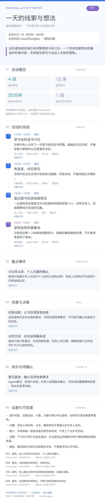

# Personal Timeline Report · 个人活动时间线简报

面向 Codex 的个人活动日报与周报 Skill。从用户已授权的 Supabase recorder-watch 读取录音、转写、AI 摘要和记忆，生成适合手机阅读的竖版 PNG、文字摘要和证据索引。



**预览中的活动、ID、统计全部为虚构测试数据，没有查询任何人的真实数据库。**

## 直接用自然语言

- “判断我昨天都做了什么，按时间顺序生成简报。”
- “总结前一周，提取重要对话、创意和待办。”
- “分析最近6小时，区分本人活动与播放的媒体。”
- “生成指定日期范围的个人活动长图，并附证据。”

也可以明确指定：`使用 $personal-timeline-report 总结昨天，按北京时间生成长图和证据索引。`

## 安装

将本仓库完整下载为 `personal-timeline-report` 文件夹，放入 `~/.codex/skills/`。保留顶层 `SKILL.md`、`agents/`、`scripts/`、`assets/` 和 `references/`。也可以把仓库链接交给 Codex，说：“安装这个 Skill，并检查是否能发现。”用户无需手动执行终端命令。

首次运行由 Agent 确认用户已授权的 Supabase 项目、表结构和用户数据范围。本仓库不预设私人项目、不包含授权凭证，不能仅凭安装获得数据库访问权限。自然语言自动选用取决于当前会话是否发现该 Skill；也可显式指定技能名称。

本地渲染需要 Python3.10+、Pillow 和中文字体。Agent 自动检查现有环境；脚本不直接联网、不调用外部生图服务、不读取数据库密钥。不捆绑商业字体，缺字体时明确报错。

## 功能与约束

- 支持昨天/前一天、上一完整自然周、滚动7天、最近N小时、自定义日期；默认 `Asia/Shanghai`，可修改。
- 只读 SELECT/元数据，分页读取并核对总数；不写入数据库、不改同步任务。
- 区分发生时间 `started_at` 与上传时间 `synced_at`，保留无转写、无录音和未定位时间的覆盖限制。
- 分别标注本人活动、多人对话、疑似媒体、推断及未知；没有可靠归属就写“说话人未知”。
- 想法、讨论、承诺、完成分别处理；待办不会自动创建或发送。
- 原始证据用录音/转写ID及时间定位，图上展示短标签；私密内容默认摘要化。

## 仓库内容

| 路径 | 用途 |
|---|---|
| `SKILL.md` | 触发与 Agent 工作流程 |
| `agents/openai.yaml` | 技能名称、示例提示及隐式调用设置 |
| `scripts/report_tools.py` | 日期、分页 SELECT 和覆盖计算 |
| `scripts/render_report.py` | 1080px自动高度PNG、Markdown与可选PDF |
| `assets/theme.json` | 浅色、编号、卡片与时间线主题 |
| `references/` | 数据字段、查询与报告JSON约定 |
| `examples/` | 完全虚构的示例数据与渲染结果 |
| `tests/` | 时间边界、权限范围、归属、缺口与导出测试 |

## 维护与验收

下面的命令供 Agent 或开发者执行，日常用户只需说需求：

```sh
python3 -B -m unittest discover -s tests -v
python3 -B scripts/render_report.py --input examples/report-demo.json --output /tmp/timeline-demo.png
```

正式报告渲染时传入 `--project-id`，与本次实际查询的授权项目匹配。渲染器不负责授权；授权范围必须先由 Agent 与连接器确认。示例不需要数据库连接。

## 可靠性与隐私

渲染器的结构检查及常见凭证拦截不能替代事实核对、说话人识别或人工隐私审阅。AI 摘要不是独立证据；有一条转写关联不等于整段完整转写；录音时长不等于本人活动或工作时长。多次 SELECT 不是同一事务快照。

公开版本只包含通用实现和虚构示例。真实活动报告、完整转写、录音文件、私人项目配置和访问凭证应保留在本地，不提交到本仓库。仓库不包含自动发布、定时执行或部署配置。
